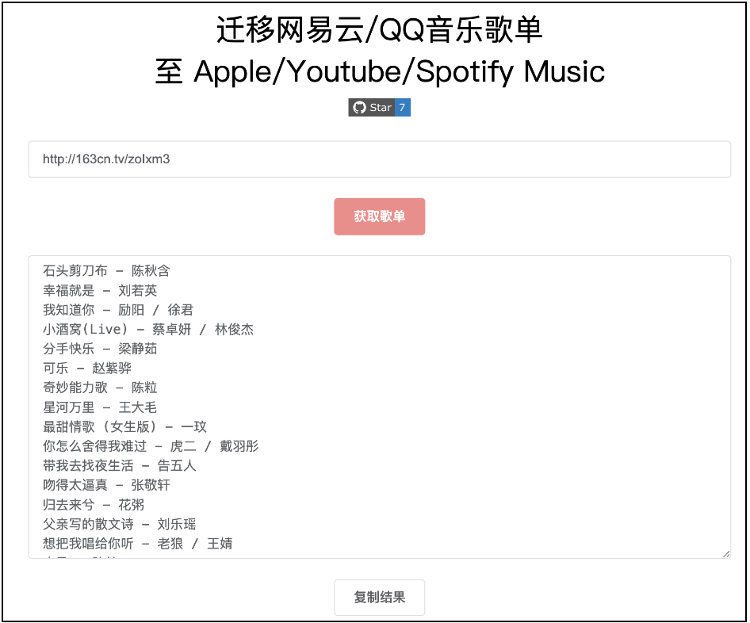

# 迁移网易云 / QQ 音乐 / 汽水 / 酷狗歌单至 Apple / YouTube / Spotify Music

> 简体中文| [English](README_EN.md) | [한국어](README_KO.md)

链接：https://music.unmeta.cn

项目后端使用 Go + Gin，前端使用 Vue 3 + TypeScript + Vite。

- 粘贴歌单链接或整段分享文字，获取公开歌单。
- 调整歌名格式和顺序，复制文本或下载 TXT；长歌单支持每 500 首分批导出。
- 显示实际获取数与平台总数，部分结果会明确提示，不将缺歌误报为完整导出。
- 默认无需数据库；可选 MySQL、Redis 缓存，支持 Docker Compose 一键部署。

支持网易云、QQ、汽水与酷狗。酷狗普通版分享页可能仅提供预览，概念版公开集合使用分页接口。私密、下架或受平台限制的内容可能无法完整获取。

开发与部署见 [DEPLOYMENT.md](DEPLOYMENT.md)，接口契约见 [docs/API.md](docs/API.md)，开源参考与实现选择见 [docs/REFERENCES.md](docs/REFERENCES.md)。

# 使用指南

> 如何迁移至 Apple/Youtube/Spotify Music

1. 输入公开歌单链接，如：https://music.163.com/playlist?id=19723756
2. 复制查询结果
3. 打开 **[TunemyMusic](https://www.tunemymusic.com/zh-CN/transfer)** or **[Spotlistr](https://spotlistr.com/)** 网站
4. 选择歌单来源“任意文本”，将刚刚复制的歌单粘贴进去，选择 Apple/Youtube/Spotify Music 作为目的地，确认迁移

> 如何迁移至网易云/QQ音乐

见 GitHub issue：https://github.com/Bistutu/GoMusic/issues/17

# 如何部署？

详见 **[部署文档](DEPLOYMENT.md)**

## Star 历史记录

# 赞赏码

网站免费、开源、保持简单，如果你想支持作者，请使用微信扫描赞赏码，以下是赞赏榜的前10名赞助者（最后更新 2025.9.10）

| 序号 |        🌼赞助者🌼        | 赞助金额 |
| :--: | :--------------------: | :------: |
|  1   | 冰楠 ₿.Ξ 🧘 |    188    |
|  2   | 高胖胖 |    101    |
|  3   | 不疯就行 |    100    |
|  4   | 魏鹏程 |    88    |
|  5   | 什么长发及腰不如短发凉 |    87    |
|  6   |         Youyo🍊         |    66    |
|  7   |         安分wa         |    50    |
|  8   |           高小伦             |   50       |
|  9   |           平             |   30       |
|  10  |        匿名用户        |    30    |
