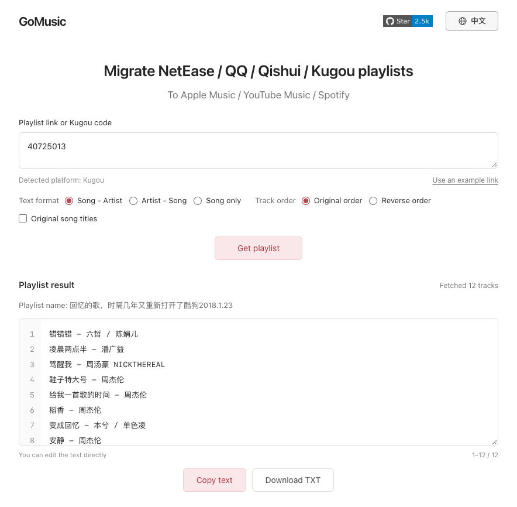

<div align="center">

# GoMusic

**Export your playlists as text. Bring them to your next music service.**

A simple, open-source tool for NetEase Cloud Music, QQ Music, Qishui and Kugou playlists.

[Try GoMusic](https://music.unmeta.cn) · [How it works](#how-it-works) · [Self-hosting](#self-hosting) · [API](docs/API.md) · [简体中文](misc/README_ZH.md) · [한국어](README_KO.md) · [MIT](LICENSE)

</div>

GoMusic turns a public playlist link or Kugou code into an editable list of song titles and artists. Copy the result or download a TXT file, then import it with a transfer service such as TuneMyMusic.



<details>
<summary>Mobile view</summary>


</details>

## Features

- **Four music sources:** public playlists from NetEase Cloud Music, QQ Music, Qishui and Kugou. Paste a link, a share message or a numeric Kugou code such as `40725013`.
- **Editable exports:** choose title–artist, artist–title or title only; reverse the order or keep the original titles.
- **Clean copy and TXT:** the editor's line numbers stay outside the exported text. Large playlists can be exported in batches of 500 tracks.
- **Visible completeness:** compare the number of fetched tracks with the platform's reported total. Partial results are clearly marked.
- **Simple interface:** desktop and mobile layouts, a visible English/中文 switch, and no music-account login required by GoMusic.
- **Self-hosting:** Go + Gin, Vue 3 + TypeScript + Vite, and optional MySQL and Redis. With MySQL configured, usage statistics persist across restarts.

## How it works

1. Open [GoMusic](https://music.unmeta.cn). Use the **English** button in the header to switch the website to English.
2. Paste a public playlist link or share message, or enter a Kugou code directly. The example link is [`http://163cn.tv/zoIxm3`](http://163cn.tv/zoIxm3); a code example is `40725013`, with no extra words required.
3. Select **Get playlist**, check the track count, and adjust the format or edit the text if needed.
4. Select **Copy text** or **Download TXT**. For large playlists, choose **500 tracks per batch** and export each batch.
5. In [TuneMyMusic](https://www.tunemymusic.com/transfer), choose a free-text or file source, import your result, and select Apple Music, YouTube Music or Spotify as the destination. [Spotlistr](https://www.spotlistr.com/) is another option for importing text into Spotify. Review the matched tracks before confirming the transfer.

GoMusic exports song metadata. Matching tracks and writing playlists to a destination account are handled by the transfer service, whose supported destinations, limits and pricing may change. GoMusic does not download audio files.

For transfers between NetEase and QQ Music, see the community discussion in [issue #17](https://github.com/Bistutu/GoMusic/issues/17).

## Supported inputs and limits

| Source              | Input                                                                           |
| ------------------- | ------------------------------------------------------------------------------- |
| NetEase Cloud Music | Official playlist links, including `163cn.tv` short links and share messages    |
| QQ Music            | Official playlist links and share messages                                      |
| Qishui              | Official playlist links and share messages                                      |
| Kugou               | Official playlist/share links, public collection links, or a numeric Kugou code |

The default retrieval limit is 10,000 tracks per request. Private playlists, removed songs and platform restrictions can prevent a complete result. Some Kugou share pages expose only a preview; GoMusic also resolves supported public collections and numeric codes, paginates their tracks, and reports any remaining shortfall. A code can expire or refer to content other than a public playlist.

See [API contracts and platform limits](docs/API.md) and [implementation references](docs/REFERENCES.md) for details.

## Self-hosting

With Docker and Compose installed, run from the repository root:

```sh
cp .env.example .env
# Change the example passwords in .env before a shared deployment.
docker compose --profile app up -d --build --wait
```

Open <http://localhost:8081>. This starts the frontend, API, MySQL and Redis; database data is stored in persistent volumes. The default ports bind to the local machine. Use an HTTPS reverse proxy for a public deployment.

You can also run without MySQL or Redis:

```sh
cd static
npm ci
npm run build
cd ..
go run .
```

The source build requires Go 1.27 (toolchain 1.27.4) and Node.js 22.12+. See the [deployment guide (中文)](DEPLOYMENT.md) for environment variables, existing database connections, frontend development and verification commands.

## API and development

- `POST /api/v1/songlists` — JSON playlist extraction; the `url` field accepts a link, share message or numeric Kugou code.
- `POST /songlist` — compatible legacy form endpoint.
- `GET /api/v1/stats` — private usage statistics for a day, week, month or all recorded time. Requires MySQL and a configured bearer token; anonymous client counts use a cookie and do not represent exact numbers of people.

Regression coverage includes large-playlist pagination, repeated or overlapping pages, short-link resolution, Kugou codes and preview results, cache fallback, persistent statistics, and browser copy/TXT behavior. The [deployment guide](DEPLOYMENT.md#验证) explains how to run unit, storage integration, race and browser tests; live provider checks are enabled separately.

## Support

GoMusic is free and open source. If you would like to support its development, scan the WeChat appreciation code. Click the image to open the original.

[](misc/images/approve.png)

Thank you to these supporters. Names and amounts are maintained manually.

| No. | Supporter              | Amount (CNY) |
| :-: | ---------------------- | -----------: |
|  1  | 冰楠 ₿.Ξ 🧘            |          188 |
|  2  | 高胖胖                 |          101 |
|  3  | 不疯就行               |          100 |
|  4  | 魏鹏程                 |           88 |
|  5  | 什么长发及腰不如短发凉 |           87 |
|  6  | Youyo🍊                |           66 |
|  7  | 安分wa                 |           50 |
|  8  | 高小伦                 |           50 |
|  9  | 平                     |           30 |
| 10  | 匿名用户               |           30 |

## Star history

[](https://star-history.com/#Bistutu/GoMusic&Date)

## License and acknowledgements

[MIT License](LICENSE). Provider research, third-party notices and the choices behind the refactor are documented in [REFERENCES.md](docs/REFERENCES.md) and [THIRD_PARTY_NOTICES.md](THIRD_PARTY_NOTICES.md).
