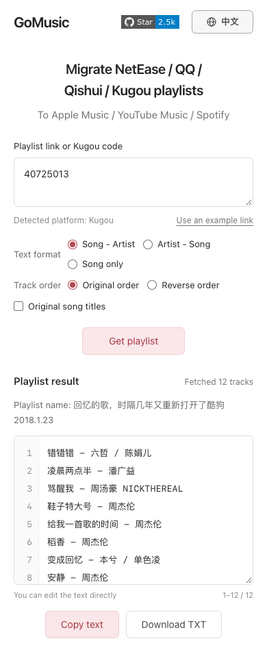

# GoMusic

**Export public music playlists from nine music platforms as text.**

[Try GoMusic](https://music.unmeta.cn) · [简体中文](misc/README_ZH.md) · [한국어](README_KO.md)

Export public playlists from NetEase Cloud Music, QQ Music, Qishui, Kugou, Kuwo, Bodian, Migu, Qianqian and Deezer.

<table align="center"><tr><td>

</td></tr></table>

Mobile view

<table align="center"><tr><td>

</td></tr></table>

## Features

- Paste a public playlist link from nine platforms, or a Kugou code such as `40725013`.
- Edit the result, choose the title/artist format and change the track order.
- Copy or download TXT, with optional 500-track batches. Displayed line numbers stay out of exports.
- Check fetched and total track counts; incomplete results are clearly marked.

## How to use

1. Open [GoMusic](https://music.unmeta.cn), select **English** if needed, and paste a link or code. [Try the example playlist](http://163cn.tv/zoIxm3).
2. Select **Get playlist**, check the result, then **Copy text** or **Download TXT**.
3. Import the text with [TuneMyMusic](https://www.tunemymusic.com/transfer) for Apple Music, YouTube Music or Spotify, or use [Spotlistr](https://www.spotlistr.com/) for Spotify. Review the matches before transferring.

GoMusic exports public playlist song information as text, not audio; the transfer service handles matching and importing. No music source credentials are needed.

## Support

GoMusic is free and open source. Scan the WeChat code to support the project, or [view the supporters](misc/SUPPORTERS.md). Click any image to open its original.

[API limits](docs/API.md) · [Self-hosting](DEPLOYMENT.md) · [NetEase ↔ QQ guide](https://github.com/Bistutu/GoMusic/issues/17) · [MIT](LICENSE) · [Credits](THIRD_PARTY_NOTICES.md)

## Star History

<table align="center"><tr><td>

</td></tr></table>
