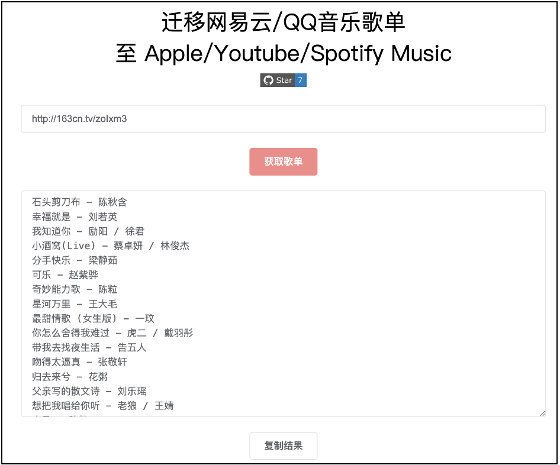
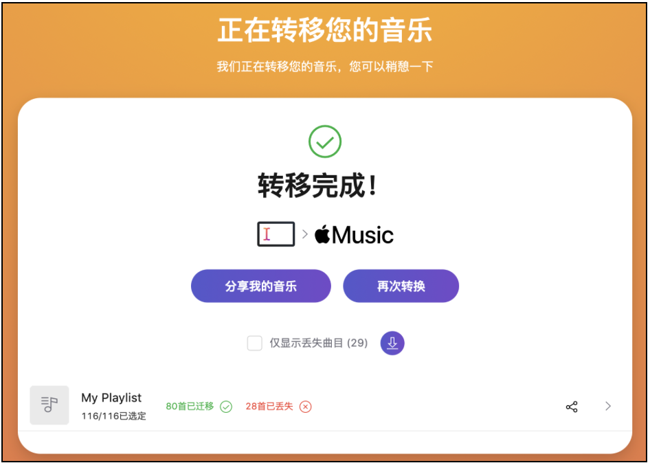

# Transfer NetEase/QQ Music Playlists to Apple/Youtube/Spotify Music

> Refactored version: NetEase, QQ Music, Qishui and Kugou public playlists, including numeric Kugou codes; Vue 3 + TypeScript + Vite; optional MySQL/Redis. See [deployment](DEPLOYMENT.md) and [API contracts and platform limits](docs/API.md).

>  [简体中文](README.md)| English | [한국어](README_KO.md)

Link: [https://music.unmeta.cn](https://music.unmeta.cn)

This project's backend uses Go + Gin, and the frontend uses Vue 3 + TypeScript + Vite.

# User Guide

1. Enter a public playlist link, for example: http://163cn.tv/zoIxm3. For Kugou, you can also enter a code such as `40725013` or `Kugou code: 40725013`.
2. Copy the search results.
3. Open the **[TunemyMusic](https://www.tunemymusic.com/transfer)** website.
4. Choose "Any Text" as the playlist source, paste the copied playlist, select Apple/Youtube/Spotify Music as the destination, and confirm the transfer.

# How to Deploy?

See **[Deployment Guide](DEPLOYMENT.md)** for details.

## Star History Record

