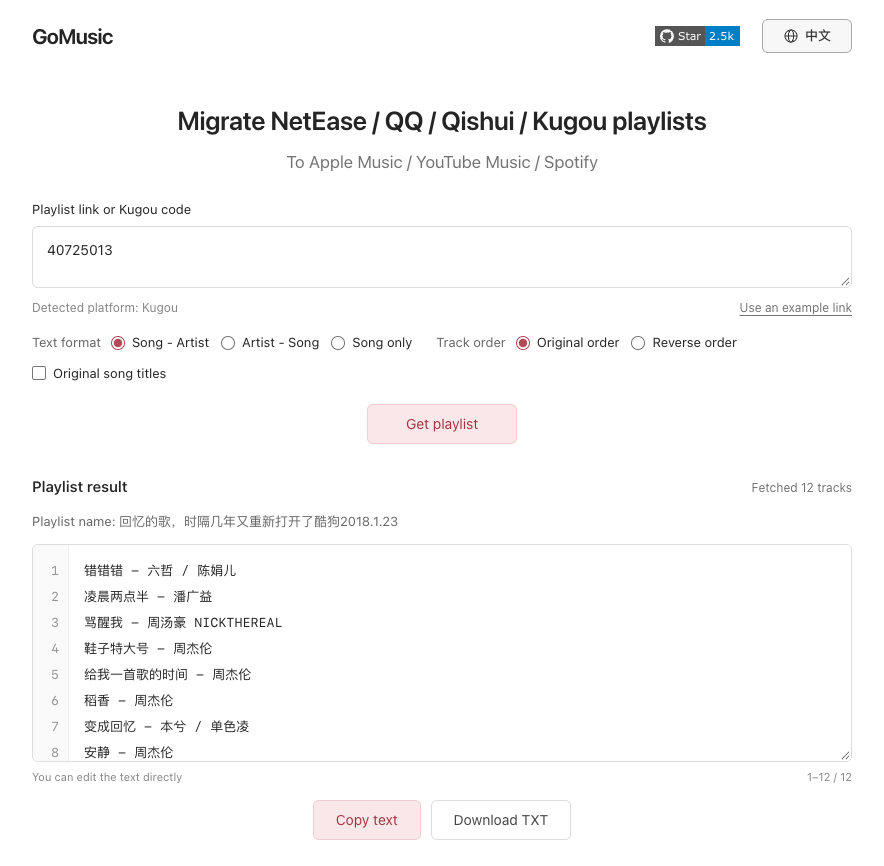
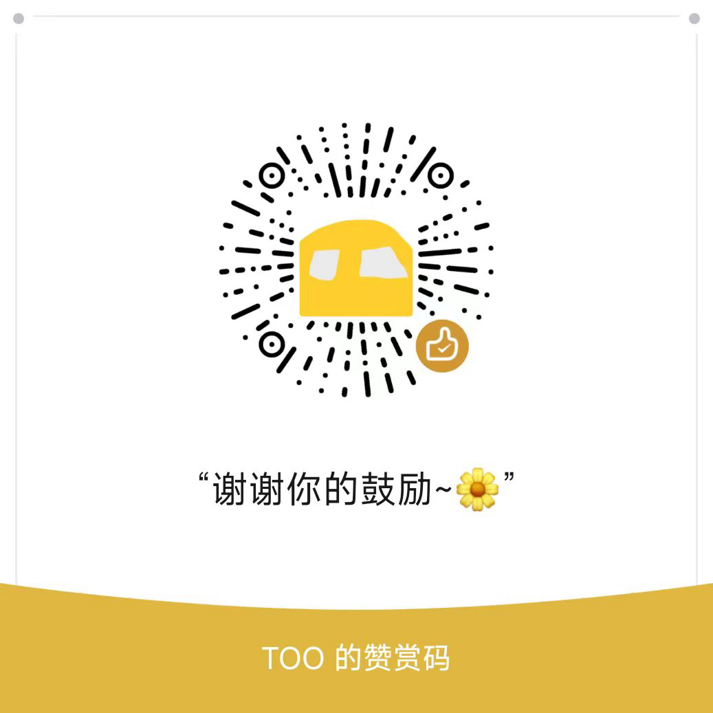

# GoMusic

**플레이리스트를 텍스트로 내보내세요.**

[온라인 사용](https://music.unmeta.cn) · [English](README.md) · [简体中文](misc/README_ZH.md)

NetEase Cloud Music, QQ Music, Qishui, Kugou의 공개 플레이리스트를 텍스트로 내보내 다른 음악 서비스로 옮길 수 있습니다. 웹사이트는 중국어와 영어를 지원합니다.

<table align="center"><tr><td>

</td></tr></table>

## 주요 기능

- 플레이리스트 링크, 공유 메시지 또는 `40725013` 같은 Kugou 코드만 입력할 수 있습니다.
- 곡 목록을 편집하고 곡명·아티스트 형식과 순서를 바꿀 수 있습니다.
- 복사 및 TXT 다운로드, 500곡씩 나누기 기능을 제공합니다. 줄 번호는 내보내기에 포함되지 않습니다.
- 가져온 곡 수와 전체 곡 수를 비교하고 불완전한 결과를 표시합니다.

## 사용 방법

1. [GoMusic](https://music.unmeta.cn)에서 **English**를 선택하고 링크나 코드를 입력합니다. [예시 플레이리스트](http://163cn.tv/zoIxm3)도 사용할 수 있습니다.
2. **Get playlist**로 결과를 확인한 뒤 **Copy text** 또는 **Download TXT**를 선택합니다.
3. [TuneMyMusic](https://www.tunemymusic.com/transfer)에서 텍스트를 Apple Music, YouTube Music 또는 Spotify로 가져옵니다. Spotify는 [Spotlistr](https://www.spotlistr.com/)도 지원합니다. 전송 전에 곡 매칭 결과를 확인하세요.

공개 플레이리스트만 지원하며 오디오 다운로드는 제공하지 않습니다. 곡 매칭과 가져오기는 선택한 전송 서비스가 처리합니다.

## 후원

GoMusic은 무료 오픈 소스입니다. WeChat 코드로 후원하거나 [후원자 명단](misc/SUPPORTERS.md)을 확인할 수 있습니다. 이미지를 누르면 원본이 열립니다.

[직접 호스팅 (中文)](DEPLOYMENT.md) · [NetEase ↔ QQ](https://github.com/Bistutu/GoMusic/issues/17) · [MIT](LICENSE) · [크레딧](THIRD_PARTY_NOTICES.md)

## 스타 기록

<table align="center"><tr><td>

</td></tr></table>
