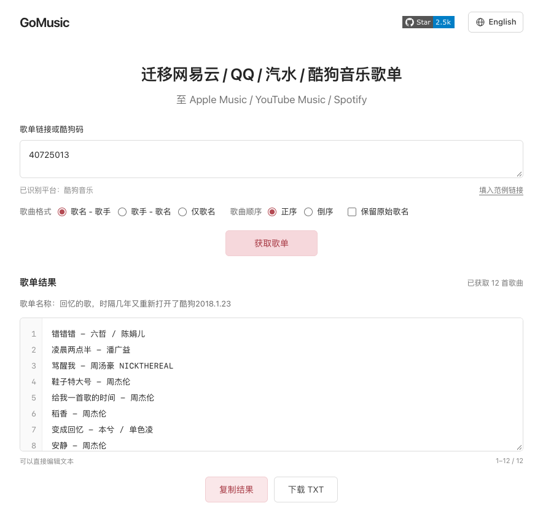
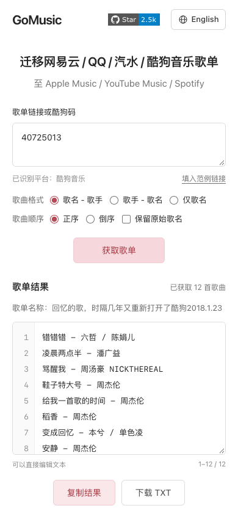

# GoMusic

**把九个平台的公开歌单导出为文本，带去下一个音乐平台。**

[在线使用](https://music.unmeta.cn) · [English](../README.md) · [한국어](../README_KO.md)

支持九个平台的公开歌单，也可直接输入酷狗码。所有音乐来源均不需要配置平台凭证。GoMusic 导出歌名与歌手文本，方便迁移到其他音乐平台。

<table align="center"><tr><td>

</td></tr></table>

查看手机界面

<table align="center"><tr><td>

</td></tr></table>

## 功能

- 粘贴九个平台的公开歌单链接，也可以只输入酷狗码，如 `40725013`。
- 自由编辑结果，调整歌名、歌手格式及歌曲顺序。
- 复制或下载 TXT，支持每批 500 首导出；左侧序号不会进入导出文本。
- 显示实际获取数量和平台总数，缺少歌曲时明确提示。

## 使用方法

1. 打开 [GoMusic](https://music.unmeta.cn)，粘贴链接或酷狗码，也可以使用[范例歌单](http://163cn.tv/zoIxm3)。
2. 点击「获取」，核对结果后「复制结果」或「下载 TXT」。
3. 通过 [TuneMyMusic](https://www.tunemymusic.com/transfer) 将文本导入 Apple Music、YouTube Music 或 Spotify；导入 Spotify 也可使用 [Spotlistr](https://www.spotlistr.com/)。迁移前请核对匹配结果。

仅支持公开歌单，不需要配置音乐平台凭证。GoMusic 导出歌曲信息，不提供音频下载；歌曲匹配和导入由迁移工具完成。

## 赞赏支持

GoMusic 免费、开源。欢迎使用微信扫码支持项目，也可以查看[赞赏名单](SUPPORTERS.md)。点击图片可查看原图。

[API 接口与平台限制](../docs/API.md) · [自行部署](../DEPLOYMENT.md) · [网易云 ↔ QQ 互转](https://github.com/Bistutu/GoMusic/issues/17) · [MIT](../LICENSE) · [致谢](../THIRD_PARTY_NOTICES.md)

## Star 历史

<table align="center"><tr><td>

</td></tr></table>
